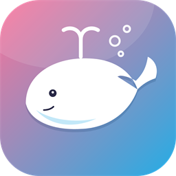

<p align="center"></p>

# astrbot_plugin_bili_whale

AstrBot 插件：让机器人每晚自主浏览 Bilibili，理解视频内容，撰写日记，将最值得分享的一条私信给主人，并把要点写入 LivingMemory 长期记忆。

插件对 Bilibili **只读**，不会点赞、投币、收藏、评论、私信、发布动态或关注。

## 功能

- **夜间自主浏览**：按作息时间窗随机唤醒 → 选题 → 粗看（简介、字幕片段、热评并打分）→ 深看（完整字幕、热评、画面）→ 写日记 → 私信分享 → 写入记忆 → 保存运行记录。
- **画面理解**：均匀抽帧并拼合为 3×3 分镜图，交由 AstrBot 中已配置的识图模型处理。
- **长期记忆**：每个深看的视频写入一条记忆（≤ 500 字，人设口吻，前半要点、后半感想），通过 LivingMemory 外部接口写入，支持一键连接。
- **成本控制**：使用 DeepSeek 时自动仅在其低价时段运行（其他模型不受影响），并设有每晚 Token 预算与分镜图上限。
- **聊天工具**：`bili_search`、`bili_video_info`、`bili_subtitles`、`bili_comments`、`bili_popular` 同时注册为 AstrBot LLM 工具，对话中可直接调用。
- **风控与安全**：请求限速；遇到风控响应当晚停止；Cookie 脱敏；视频标题、简介、评论等一律作为“引用材料”处理，防止提示词注入。

## 环境要求

| 项目 | 要求 |
|---|---|
| AstrBot | ≥ 4.16 |
| Python | ≥ 3.10（依赖 `aiohttp`、`tzdata`，其中 `aiohttp` 已随 AstrBot 安装；均支持 aarch64） |
| ffmpeg | 可选。未安装时仅读取文字（字幕、简介、评论），不读取画面 |
| 识图模型 | 任一支持图片输入的 AstrBot 提供商（如 DeepSeek `deepseek-flash`、GPT-4o、Gemini、Qwen-VL 等），与文本模型相互独立 |
| LivingMemory | 可选。需 ≥ 2.11.0 并启用“外部记忆 API” |

## 安装

1. 将本仓库克隆到 AstrBot 的插件目录，并在 WebUI 中重载插件：

   ```powershell
   git clone https://github.com/qualcone/astrbot_plugin_bili_whale.git data/plugins/astrbot_plugin_bili_whale
   ```

2. （可选）在容器内安装 ffmpeg。**重建或升级容器后需要重新安装**：

   ```powershell
   docker exec -u root astrbot apt-get update
   docker exec -u root astrbot apt-get install -y ffmpeg
   ```

3. 插件的状态、日记与运行记录保存在 `data/plugin_data/astrbot_plugin_bili_whale/`（`state.json`、`diary/`、`runs/`），升级插件不会丢失。

## 快速配置

### 1. 连接 Bilibili

1. 使用浏览器登录 Bilibili（建议使用小号）。
2. 打开开发者工具（F12）→ **Application（存储）** → **Cookies** → `https://www.bilibili.com`。
3. 复制 `SESSDATA` 的值（原样复制，不要自行解码），填入插件配置的 **Bilibili SESSDATA**。建议同时复制 `buvid3`。
4. 填写 **主人 QQ 号**，保存并重载插件。
5. 让主人 QQ 先私聊机器人一次，以便插件记录私聊会话。
6. 发送 `/bili check`，“cookie”一行应显示有效。SESSDATA 过期后需重新获取。

SESSDATA 仅保存在插件配置中，不会出现在日志、日记、记忆、提示词或私信里。

### 2. 配置模型

- **文本模型提供商**：用于打分、总结与写日记，留空使用主人会话当前的聊天提供商。
- **识图模型提供商**：在 AstrBot 的“模型提供商 → 对话”中添加一个支持图片输入的模型（例如 DeepSeek 的 `deepseek-flash`），然后在此项中选择它；留空则使用上方的文本模型提供商。识图与文本模型可以是不同厂商。
- **画面理解策略**：`始终`（默认）/ `自动`（仅在无字幕或字幕过短时读取画面）/ `关闭`。

### 3. 验证

依次执行 `/bili check` → `/bili test` → `/bili wake`，详见“首次验证”。

## 命令

以下命令仅管理员可用。

| 命令 | 说明 |
|---|---|
| `/bili status` | 下次唤醒时间、今日已看与已分享、Token 用量、Cookie、ffmpeg、LivingMemory、风控状态、当前计价时段 |
| `/bili check` | 自检：Cookie、WBI、搜索、字幕、直链、抽帧、识图模型、LivingMemory，每项一行 |
| `/bili test [BV号或链接]` | 测试唤醒：强制深看指定视频（默认内置测试视频），**不写日记、不写记忆、不私信、不标记已看**，结果直接回复，详情见 `runs/test_*.json` |
| `/bili wake` | 立即完整运行一次（会写日记、私信、写记忆）。高价时段会被拒绝，`/bili wake force` 可强制运行并清除当日风控标记 |
| `/bili plan` | 查看今日计划（✔ 已执行，· 待执行） |
| `/bili diary` | 发送最近一篇日记 |
| `/bili lm connect` | 一键连接 LivingMemory |
| `/bili lm status` | 查看 LivingMemory 连接状态 |

## LivingMemory 集成

写入通过 LivingMemory 的本机 HTTP 外部接口完成，插件仅调用接口。每个深看的视频一条记忆，`idempotency_key` 为 `bili-whale-<BV号>`，重复运行不会重复写入；重要度 0.4–0.5，`source` 为 `bili_whale`。写入失败只记录日志并在 `/bili status` 中显示，不影响日记与私信。

### 启用与连接

1. 确认 LivingMemory 版本 **≥ 2.11.0**（外部接口自该版本加入）。
2. 在 LivingMemory 的配置页找到 **“外部记忆 API”** 分组，启用 `external_api.enabled`（默认监听 `127.0.0.1:7801`），重载 LivingMemory。
3. 管理员发送 `/lmem apikey create bili_whale write` 生成令牌（以 `lm_` 开头，仅显示一次，需写权限）。
4. 将令牌填入本插件的 **LivingMemory API 密钥**。
5. 发送 `/bili lm connect`（或保持“启动时自动连接”开启）。该命令会检测接口、读取人格与会话范围、自动选择并写回配置、启用写入。

### 自动选择规则

LivingMemory 的私聊召回只匹配“**私聊会话范围 + 当前人格**”；不带这两项写入的记忆会落入全局范围，私聊中无法召回。因此：

- 密钥设有人格或范围白名单时，对应项留空，由服务端取白名单第一项。
- 记忆库中尚无记忆时，候选为空，自动使用**主人私聊会话**作为范围、**机器人当前人格**作为人格。
- 只有一个候选时直接选择（不会选择全局范围）；有多个候选且无法判定时，列出候选，请手动填写。
- 已手动填写的人格与范围不会被覆盖。如不希望自动配置，关闭“启动时自动连接”。

> 人格 ID 是召回过滤的依据。修改人格提示词内容不影响记忆召回，但**重命名或更换人格**后，需手动更新“记忆所属人格 ID”。

### 嵌入模型

LivingMemory 写入时需调用嵌入模型。若出现 `internal_error`，请先查看 AstrBot 日志，常见原因是嵌入提供商的模型名无效或维度与已有向量索引不一致。

## 画面理解（分镜图）

处理流程参考了 dsh-video-vision 的分镜图思路：均匀抽取至多 N 帧，统一缩放为 426×240，每 9 帧用 ffmpeg 的 `tile` 滤镜拼合为一张 3×3 分镜图（约 1278×720，无需 Pillow），多张分镜图一次提交，提示词中注明每一格对应的视频时间点。

- 通过 AstrBot 提供商接口调用（`provider.text_chat`，图片以本地路径传入），与 AstrBot 内置“图片转述”同一路径。
- Token 消耗取决于所选模型的图片计费方式。以 DeepSeek 为例，文档标注单张图片最多约 1024 Token，18 帧（2 张图）约 2k Token。
- 未安装 ffmpeg、取不到直链、识图失败或达到上限时，自动降级为仅读文字，日记中会说明“没看到画面”。

## 视频内容如何传递给对话模型

对话（文本）模型**从不直接看图**，识图模型与文本模型是两个独立环节，通过“文字”衔接：

1. **识图模型**读取分镜图，输出一段**画面描述**（文字）。
2. 画面描述、字幕、简介、热评一起放进“引用材料”，交给**文本模型**生成总结、感想、日记与私信。因此识图模型可以与文本模型是不同厂商、不同模型，二者互不依赖。
3. 总结和感想会写成**每视频一条记忆**存入 LivingMemory。之后与主人私聊时，LivingMemory 把相关记忆（文字）注入对话上下文，机器人即可“回忆”起看过的内容。
4. 完整日记保存在 `diary/` 目录，不进入记忆；如需回看具体视频，对话中可调用 `bili_video_info`、`bili_subtitles` 等工具重新读取。

画面描述的质量取决于识图模型；没有画面描述时（未装 ffmpeg、识图失败等），总结仅基于字幕、简介与热评，并在日记里注明“没看到画面”。

## 成本与时段

- **低价时段调度**（`offpeak_mode`，默认“自动”）：仅当当前使用 DeepSeek 时生效（通过提供商 ID、接口地址或模型名识别），使用其他模型时自动不限制，也可手动设为“关闭”。DeepSeek 高价时段为北京时间工作日 9:00–12:00、14:00–18:00，其余为低价（价格为高价的一半）。时区按固定 UTC+8 换算，不受服务器时区影响。计划时刻避开高价；到点处于高价则顺延（超过 2 小时作废）；流程中途进入高价则停止深看。伦敦时间 21:00–23:00 对应北京时间次日 5–7 点，默认作息始终处于低价时段。法定节假日可填入“法定节假日”配置项。
- **Token 预算**（默认 10 万/晚）：文本与识图合计，文本部分按字符数估算（约 1.5 字/Token）。达到后停止深看，仅用已有素材写日记。可用 `/bili status` 查看用量。
- 以 DeepSeek `deepseek-flash` 为例，低价时段约 1 元/百万输入 Token、4 元/百万输出 Token，10 万 Token 约 0.1 元；价格以官方定价为准。其他模型请按各自价格调整 Token 预算。

## 风控与风险提示

- 请求间隔默认随机 2–4 秒；遇到 HTTP 412/429 或业务码 -352、-412、-799 时，当晚停止所有 Bilibili 请求且不重试，原因显示在 `/bili status`。
- 使用个人 Cookie 访问 Bilibili 存在被风控甚至封号的风险，建议使用小号、保持低频。
- 海外机房 IP 可能被限制或遇到地区限制（-10403），取不到直链时自动降级。
- 遇到 412：插件会在首次请求前预热浏览器 Cookie（`buvid3`、`b_nut` 等）并补全请求头；如仍出现，可手动填写 `buvid3`、调大请求间隔。
- Cookie 仅发送至 `api.bilibili.com`，不会发往字幕 CDN 等其他域名。

## 首次验证

1. `/bili check`：每一项应为 ✅，失败项会写明原因。
2. 让主人 QQ 私聊机器人一次，或在配置中填写主人会话标识。
3. `/bili test`：用测试视频验证“字幕与评论 + 抽帧 + 识图 + 总结”链路，不写日记与记忆。
4. `/bili lm connect`：连接 LivingMemory。
5. `/bili wake`：完整运行一次。随后：
   - `/bili diary` 查看日记，对照文末“今晚看过”核对事实；
   - 查看 QQ 私信（免打扰时段内的分享会推迟）；
   - 在私聊中发送 `/lmem search 看过`，确认记忆已写入且可召回；
   - `/bili status` 确认 LivingMemory 一行为成功。
6. 重启 AstrBot 后，`/bili plan` 与 `/bili status` 中的计划与已看记录应仍然存在。

## 测试

```powershell
pip install pytest aiohttp tzdata
cd data/plugins
python -m pytest astrbot_plugin_bili_whale
```

覆盖 WBI 签名、作息与低价时段、计划持久化、已看去重、日记路径与幂等写入、LivingMemory 载荷与自动选择、配置解析、脱敏、JSON 提取等纯逻辑。与 AstrBot、Bilibili 真实接口、ffmpeg、识图模型及 LivingMemory 的集成需在实际环境中验证。

## 更新日志

见 [CHANGELOG.md](CHANGELOG.md)。

## 致谢与许可

- 思路与 Bilibili 接口用法参考 [Alterssss/dsh-bili-whale](https://github.com/Alterssss/dsh-bili-whale)（MIT）；分镜图思路参考 dsh-video-vision。本插件为 Python 独立重写，未复制其代码。
- LivingMemory（[astrbot_plugin_livingmemory](https://github.com/lxfight-s-Astrbot-Plugins/astrbot_plugin_livingmemory)，AGPL-3.0）仅通过其 HTTP 接口调用，未复制其代码。
- 本插件以 MIT 协议发布，见 [LICENSE](LICENSE)。
